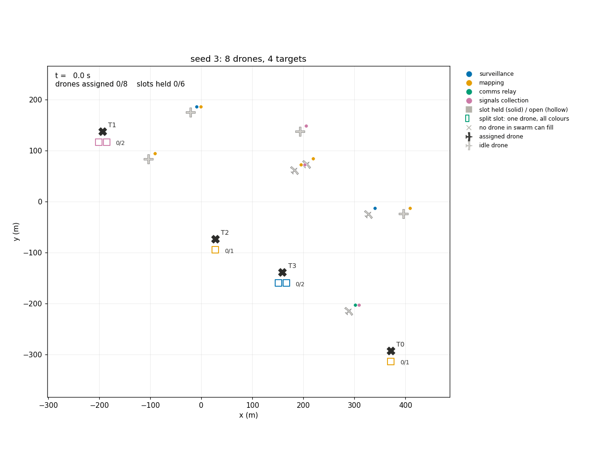
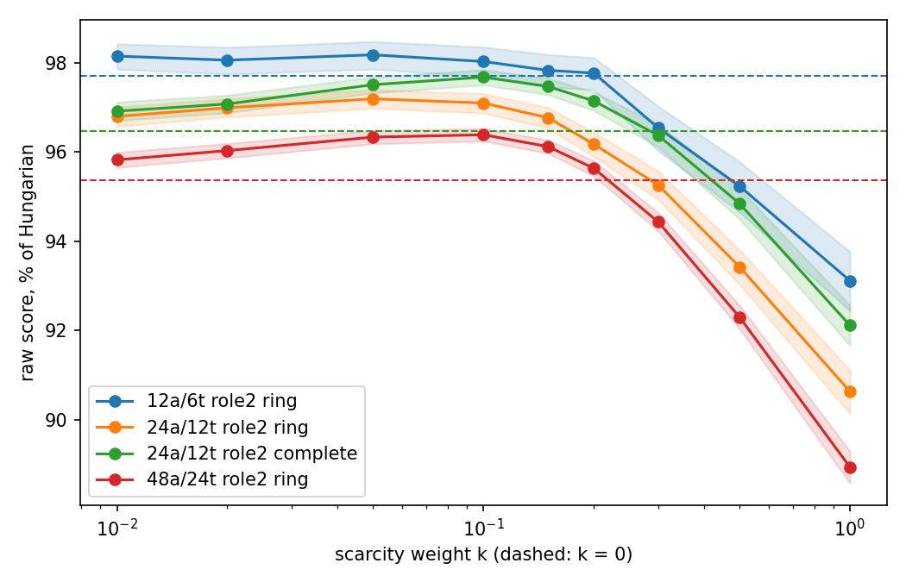

<!-- OUTLINE. Delete before committing. -->

# Consensus-Based Decentralized Auctions for Heterogeneous Drone Swarms
[](https://github.com/stephen-barr/swarm/actions/workflows/tests.yml)



This is a from-scratch Python implementation of decentralized task allocation for a heterogeneous drone swarm. The fundamental problem it aims to solve is as follows:

***How can a swarm of heterogenous agents agree on capability-dependent task allocation using only peer-to-peer communication?*** 

And additionally:

 How can such an agreement adapt to newly discovered tasks and when messages are dropped, arrive late or out of order?

Such a question is of broad interest to the field of autonomous systems. Consider the example below to illustrate its practicality:

*Medical triage via unmanned vehicles requires real-time assignments dependent on capability. Such systems are often needed in hostile environments where RF communication is jammed, leading to packet loss. How can a swarm accurately allocate capabilities to casualties?*

## Key Results
- Auctions give allocations between 95.4–99.3% of optimal on 800 instances of 6–48 agents.
- The auction gives consistent allocation regardless of network topology with 1,600/1,600 ring and line topology instances consistent with the fully connected topology.
- Scarcity weighting closes 22–37% of the gap to the globally-solved optimal allocation for 6–15% more rounds (assuming no information is known about other agents capabilities before the beginning of the auction) in 2,000 paired instances.

## Overview
The consensus-based auction algorithm (CBAA) is a decentralized method to reach agreement (or consensus) among independent agents only utilizing peer-to-peer communication. While, global solvers such as the Hungarian algorithm are provably optimal for assignment problems in polynomial time. CBAA provides the same assignment as a global greedy algorithm over agent/assignment pairings, which is provably within half of the optimal Hungarian assignment.

We implement an auction algorithm for heterogenous agent swarms with differing capabilities and attributes (drawn from DoD UAS group specification) and targets with specified capability slots. Example: two slots, one slot filled by an agent with either surveillance OR striking and one slot filled by an agent with signals collection AND striking.

Notably, we introduce scarcity weighting which prioritizes slots that are harder to fill given requirement/capabilities. This recovers roughly a third of the scoring gap between the naive greedy and optimal Hungarian solution.


### Scoring
Agents utilize a time-to-arrival scoring methodology. Where the time to arrival is calculated as $t = t_m + \frac{d}{v_{\text{cruise}}}$, where $t_m$ is the current time since the beginning of the mission, $d$, the current euclidean distance from the agent to the target, and $v_{\text{cruise}}$, the cruise velocity of the agent (as specified by the class).

Additionally, we weight a target's importance using two factors, a linear weight $V$ representing how much the task is worth, and an exponential term $\tau$ representing the scale of time decay. Without the linear component, every score would be worth the same at equal distance and time zero. Without the time decay term, the model would lack a sense of *urgency* between two generic targets. 

Thus, we have a general score model:
$$\text{score} = V e^{-t/\tau}$$

Notably, the value of a target halves every $0.69 \tau$. Some generic scores are given as a function of time to arrival below:

<p align="center">

</p>


### Scarcity-Aware Bidding
<figure>

<figcaption> Scarcity weighting allows two extra slots to be filled, increasing score from 88% of optimal to 96% of optimal, at a cost of three seconds for further agent travel. </figcaption>
</figure>

In heterogenous systems naive scoring does not account for the scarcity of a capability in a swarm relative to the demand of the targets.

In the naive case above, the auction completes with slots on target 4 (T4) and target 7 (T7) empty. This is in spite of agents with the necessary capabilities existing. Those agents, instead fill slots that they naively weight higher, winning such an auction against agents with cardinally less capabilities. Thus, in the Hungarian optimal case the agents would have formed a solution to maximize the number of slots filled (or closely, one that maximizes the total score). 

Optimally, we would like agents to have some recognition of the scarcity of a given capability relative to the average slot. In addition, we would like this process to occur entirely decentralized. We propose the following solution:

Agent's hold a local dictionary, `census`, which consists of agent_id's linked to a list of capabilities they hold. Peer-to-peer sharing includes this census (flagged) in its outbound message payload whenever its census increases from inbound messages and periodically (set by the attribute `resend_period`). 

This design allows for agents to have any varying degree of census information at the start of the mission, and for agents to be added mid mission even with packet loss (future implementation). Note that in ALL metrics given, we assume the worst case of no census information given. Thus the agent, must construct its census entirely from received messages. With the census provided before the auction, there is no significant evidence of additional rounds compared to the naive scoring baseline.

Each agent in a connected network will eventually complete the full census of its network. Empirically starting from an empty census on every agent, this happens much faster than auction convergence, and a proof of this is rather trivial (all information shared is consistent).

The naive scoring generated from before is multiplied by an exponential of the relative scarcity of the slot relative to an "average slot". 

We consider the ratio of the number of agents able to fill a slot requiring some capability $r$, $n_r$, and the number of slots requiring $r$, $d_r$. This of course has units of agents/slots. To eliminate the units which become render comparison between missions inconsistent, this ratio is divided by the ratio of total agents to total slots. Thus, this pseduo-scarcity is given by
$$a_r = \frac{n_r / d_r}{N / D},$$ with an important caveat: it is inverted relative to the idea of scarcity.

$a_r$ is large when a slot has many agents available to bid on it, and small when it has few, thus we might refer to it as an *abundance* parameter (yes, I know, very clever).

The proper weighting of this scarcity weight is paramount; too small and the agents are not incentivized to give up closer targets, too great and all agents will go to the scarcest slots, completely disregarding the naive score. We determine this weighting $k$ from an empirical sweep over possible values. The full scarcity weighting formula is

$$w_r = \exp\left(-k a_r \right) = \exp\left(-k \frac{n_r / d_r}{N / D}\right)$$

and the full score of one slot is given by

$$\text{score}_{scarce} = V e^{-(t/\tau + ks_r)} $$

Considering the aforementioned census sharing during auctioning, each agents scarcity weighting at the start of the auction in the worst-case (no census information on other agents) is
$$w_r = \exp\left( \frac{1 / d_r}{1/D} \right) = \exp\left( \frac{D}{d_r} \right),$$ which is the minimum of this weight as $n_r / N \leq 1$. Relating to the system, this acts as a penalty to more uncertain early bids, but creates rebidding and rescoring as drones increase their bids later, leading to marginally more rounds than other approaches.

### Versioned Bids
Naive CBAA never requires agents to release previously held bids, as bids are required to monotonically decrease. The scarcity scoring introduces the need to release a bid that an agent holds as it learns of a rarer slot.

A versions table, `latest`, is introduced which tracks the most recent transmission from other agents. The most recent version from the agent is considered. `latest[i]` is the highest version a given agent has heard about from agent `i`. An agent only bumps its own version inside of `auctionPhase()` when it writes a new bid to `winners` or rescores its currently held slot.

Note that the auction in the theoretical worst case necessarily converges in finite rounds, as the census converges in finite rounds

Two bugs formed in the first implementation which are noteworthy:

1. **Phantom Bids, October 19th, commit 27b608f.**
Version never updated when an agent was outbid. Suppose an agent $A$ makes an initial bid (score = 0.6, version = 1) on slot $S_1$. This bid is transmitted to $C$ and $C$ records it in it's `winners` and `latest` table. Now, $B$ outbids $A$ on $S_1,$ $A$ hears this and drops the slot. Before this reaches $C$, $B$ moves to a different slot, $S_2$, $C$ still holds the original bid from $A$. This bid is then transmitted back to $A$, $A$ sees the version of its own bid and merges it into its `winners` table as the version is the same as it's current version.
    &nbsp;
    This caused all tables to end in agreement, but filled with slots that were not held by the corresponding agents of the bids. It affected 16 of 720 test runs with scarcity weighting.
    &nbsp;
    The solution was to simply bump version number whenever an agent is outscored on its held slot.
&nbsp;
2. **Out-of-order bids, November 3, commit 5dc0de7**
With random delay introduced, stale bids could arrive after fresh bids. Suppose agent $A$ places bid (score = 0.5, version=3) on slot $S_1$; agent $B$ records this, changes `winners[S_1] = (0.5, v3)`and `latest[A.id] = 3`. Agent $A$ then bids on slot $S_2$ with (0.7, v4). The second bid, arrives to $B$ faster than the update to `latest`. $B$ updates `latest[A.id] = 4` but does not prune the previous bid `winners[S_1]`. Any subsequent bid lower than 0.5 on $S_1$ is rejected as it cannot beat the stale bid from $A$. 
&nbsp;
  The solution is to simply prune all entries in `winners` where the version is lower than the current version. Pretty simple.

## Scarcity Weighting: Results
$k=0.1$ was chosen by varying $k$ over nine different values, running each auction on the same 2000 seeded instances (500 per agent/target setup). For each setup, the paired bootstrap 95% confidence interval does not include zero gain, indicating a statistically significant result. 



To eliminate selection bias in the choice of $k$, the auction was run on 2000 new instances at $k = \{0.0, 0.1\}$. The summary is listed below:

| Setup | % opt, k = 0 | k = 0.1 | Gap closed | Slots filled | Rounds |
|---|---|---|---|---|---|
| 12 drones / 6 targets, ring | 97.38 | 98.35 | 37% | 8.57 → 8.75 | 15.1 → 17.3 |
| 24 / 12, ring | 96.19 | 97.18 | 26% | 20.03 → 20.56 | 38.5 → 42.1 |
| 24 / 12, complete | 96.19 | 97.42 | 32% | 20.03 → 20.55 | 5.9 → 6.8 |
| 48 / 24, ring | 95.45 | 96.46 | 22% | 43.81 → 44.99 | 97.3 → 102.8 |


We define the gap closed as
$$\text{gap closed} = \frac{\text{score}_{\text{scarce}} - \text{score}_{\text{naive}}}{\text{score}_H - \text{score}_{\text{naive}}}.$$ Where each score is the sum total of filled slots scored at mission start by the naive scoring (distance and ). The ratio of the gaps between the naive and scarce scores and the naive and hungarian optimal scores.

The increase in score comes almost entirely from filling more slots. In 41.6% of instances scarcity weighting fills at least one or more slot than plain CBAA, and in 1.3% it fills fewer. In the remaining 57% of instances, the number of slots filled does not change and we find the average score decreases by a modest 0.10 percentage points of optimal. When scarcity weighting only permutes the agent-target pairs, agents are sometimes reassigned from targets they score highest.

## Benchmark: Auction vs Optimal
Plain CBAA (k=0.0) was compared to the Hungarian optimal solution in 800 instances (200 seeds over 4 setups) of agents and targets in a 1000m x 1000m grid. Each agent has 1-3 roles, each comprising at most two capabilities. Connected, ring, and line topologies are solved for every instance.

| Drones | Targets | Infeasible | Mean % of optimal | 5th percentile | Worst | Exactly optimal | Coverage | Same as greedy |
|---|---|---|---|---|---|---|---|---|
| 6 | 3 | 6 | 99.3% | 98.7% | 69.5% | 94% | 99.1% | 98% |
| 12 | 6 | 0 | 97.9% | 90.4% | 83.6% | 55% | 96.7% | 92% |
| 24 | 12 | 0 | 96.7% | 92.1% | 89.2% | 10% | 95.7% | 72% |
| 48 | 24 | 0 | 95.4% | 91.5% | 85.8% | 0% | 95.7% | 43% |


CBAA is theoretically proven to allocate to at least half of the Hungarian optimal result. Empirically, the algorithm's worst allocation was 69.5% of the Hungarian algorithm, an outlier as the 5th percentile remained above 90% of optimal for all four setups. Auction convergence is theoretically bounded by the product of the diameter of the network and the number of slots. The longest convergence relative to this bound occurred for a 6 drone complete instance, which required 69.5% of the theoretical maximum rounds. The best instance (48 drones, line topology) required only 5%.

## Flight Dynamics and Mission Simulation
Dynamics of the agents are added to consider how dynamically changing position of the agent affects convergence of the auction.

### Platforms
| Class | Example | Mass | v min / cruise / max (m/s) | Accel / decel (m/s²) | Max bank | Roll rate |
|---|---|---|---|---|---|---|
| Group 1 multirotor | Skydio X2D | 2.5 kg | 0 / 12 / 16 | 5 / 5 | 27° | 300°/s |
| Group 1 fixed-wing | RQ-11 Raven | 1.9 kg | 9 / 13 / 22 | 2 / 1.5 | 45° | 75°/s |
| Group 2 | ScanEagle | 22 kg | 18 / 25 / 41 | 1 / 1 | 35° | 65°/s |
| Group 3 | RQ-7 Shadow | 210 kg | 25 / 36 / 56 | 1 / 0.8 | 30° | 70°/s |
| Group 4 | MQ-1C Gray Eagle | 1,630 kg | 30 / 55 / 77 | 0.8 / 0.8 | 30° | 19°/s |
| Group 5 | MQ-9 Reaper | 4,760 kg | 45 / 90 / 123 | 1 / 1 | 30° | 26°/s |

### Dynamics
Each agent is considered as a kinematic point mass in the two-dimensional plane. 

Fixed wings follow the standard coordinated turn model with a roll rate limit given by $a_{lat} = g\tan\phi$ and $\dot\chi = a_{lat}/v$, where $\phi$ is the bank angle and $\chi$ the course angle. The rate of change of bank is never greater than the roll rate limit $\dot\phi_{max}$, and agents never fly slower than $v_{min}$. 

Multirotors can hover and their acceleration is limited by their maximum tilt, $g\tan\phi_{max}$.

### Guidance

Guidance dictates $\mathbf{a} = (\mathbf{v}_{des} - \mathbf{v})/\tau_g$.
The guidance time constant $\tau_g$ is chosen so that $\tau_g  = \phi_{max}/{\dot \phi_{max}}$. That is, the time required for an agent to go from level to its maximum bank angle at its maximum roll rate. 

 Multirotors fly directly to the target, brake, then hover over it. Speed is taken to be the minimum of cruise speed, the kinematically-derived fastest braking speed, $v = \sqrt{2a_b d}$, where $a_b = 0.8 |a_{min}|$ (arbitrary safety padding),  and the critically damped speed, $v = \frac{d}{4 \tau_g}$, where $\tau_g$ is the same velocity time constant. Far from the target the minimum is the cruise speed, then transitions into the fastest braking speed, then the critically damped speed, so as to not overshoot the target.
 
Fixed-wing agents orbit the target using vector-field path following (Beard & McLain, 2012). Their speed is given similarly by the minimum of cruise speed and the fastest braking speed down to the loiter speed, $v = \sqrt{v_{loiter}^2 + 2a_b(d-R)}$, using the same tolerance of $a_b = 0.8|a_{min}|$. The agents orbit their target at a radius of $R = 1.4\,v^2/a_{lat, max}$ and a speed of $1.25 v_{min}$; both margins were chosen rather than tuned.

If the agent is unassigned, `agent.getDestination()` returns the centroid of slots open in the its table (targets with two open slots are counted twice). If no such slots exist, the method returns None, which is handled in `agent.step()` by loitering/hovering in place depending on the agent spec.


### Mission Loop and Visualizer
`runMission` runs the control loop for the physics and radio of the agents. Every 20 ms (can be passed in) each agent takes a physics step (guidance, then dynamics), and every 100 ms (also can be passed in) the swarm runs one radio round (bid, send, receive). Bids are scored from each agent's current position and the mission clock. The mission ends once no table has changed for (maximum message delay + 1) rounds and every assigned agent has arrived (multirotors within 1 m, fixed wings within $1.2R$), or after the maximum time.

The visualizer (`sim/`) replays a recorded mission in matplotlib, with slots under each target filling as they are won; `--compare` plays scarcity off and on side by side:

    python -m sim.mission_demo --seed 47 --agents 16 --targets 8 --compare --save mission.gif

## Status and Direction
1. **Plain CBAA - done.** 
    Single assignment per agent with distributed communications.
2. **Delayed messages - done.**
    Messages may be finitely delayed, but are never dropped, see 7.
3. **Scarcity scoring - done.** 
    Capabilities of other agents passed through auction payload as a census (truly peer to peer).
4. **Versioning of bids - done.** 
    Agents bids are withdrawn when outbid on assignments or more optimal slot exists, corrects bug of stale bids.
5. **Dynamics, guidance, and visualization - done.**
  Bids depend on agent position and time since beginning of mission. Visualization of instances in matplotlib.
6. **Tasks arriving mid-mission — next.**
   The information available to each agent after the census is fully shared, allows each agent to independently solve the global optimal solution. Thus, the architecture justifies itself only in instances where agents hold locally known information. One such example is target recognition and transmission mid-mission.
7. **Agents arriving mid-mission - next.**
    Agents may be added to the swarm via sending their capabilities table and receiving a target list. The agent becomes identified to other members of the swarm through transmission of latest tables by itself and others.
8. **Randomly dropped bids - soon.**
    Messages may be randomly dropped, requiring communication protocol to send latest table more often. This feature will provide expectations for a port to ESP32 chips and full hardware.

## Assumptions
  - All auction information is shared truly locally, with a Channel class representing only the physics of delivering messages to another independent system.
  - Termination of the auction occurs with an "omniscient observer", that is no disagreement in information exists between agents. Specifically, the winners table (slots assigned to bids), latest table (version of last heard message from each agent), and census table (the capabilities of every agent in the swarm) agree for all agents for a period of $\text{max message delay} + 1$ rounds.
  
    This is a defensible simplification, as naive and sophisticated methods exist for determining the end of an auction in a distributed system. Choi et al. [^choi] demonstrate that the theoretical maximum bound for convergence is $$\text{min} \{\text{slots}, \text{agents} \} \times \text{network diameter}$$ in auctions with synchronous rounds and atemporal bids. 
  
    Sophisticated methods include Dijkstra–Scholten acknowledgment trees and Safra’s algorithm, which decrease such termination acknowledgement costs. Notably, all such methods require consistent channels between agents, auction termination under packet loss is non-trivial.

    Additionally, the architecture of the auction supports such a simplification as agents dynamically act prior to auction convergence. In every recorded instance, auctions converged prior to flight time. We, however, acknowledge pathological cases may exist and such a conclusion in expensive physical systems would require more substantive analytical proof.

  - Only attributes and features which necessarily change the architecture, scoring, or allocation of the auction process are considered.

  - Agents may be a composition of different capabilities and dynamics (fixed wing vs multirotor) with capabilities not linked to vehicle class.

  - Dynamics may be solved via PX4 and other open-source autopilot packages. Thus, dynamics are only considered for the purpose of analyzing bidding protocols in flight and for visualization.

  - No agent knows the capabilities of other agents at the start of the auction (allowing other agents to join auction). Instead all information is shared inside of message payloads.

  - All targets and their requirements are known to all agents at the start of the auction. Target acquisition to come.

## Reproducing
- `pip install -e .`
- `pytest` (2,114 tests)
- `python -m experiments.benchmark` → `python -m experiments.summary > results/benchmark_summary.md` (benchmark; commit 0d90278)
- `python -u -m experiments.k_sweep run --seeds 500` → `python -m experiments.k_sweep analyze > results/k_sweep_summary.txt` (initial k sweep; commit 0d90278)
- `python -u -m experiments.k_sweep run --seeds 500 --seed-offset 500 --ks 0 0.1 --results results/k_sweep_fresh.csv` → `python -m experiments.k_sweep analyze --results results/k_sweep_fresh.csv --figure results/k_sweep_fresh.png > results/k_sweep_fresh_summary.txt` (fresh 500 instances; commit 3b62620)

## Tests
- *test_auction.py* 
  Tests for auction mechanics, small examples of mission mechanics.
- *test_baseline.py* 
  Tests baselines (Hungarian, Greedy) do what they should.
- *test_comm.py*
  Tests communication in channel

## Layout
```
swarm/                     the algorithm
  models.py                shared types, platform specs, scoring
  agent.py                 bidding, merging tables, census, versions, flying
  comms.py                 simulated network, constant and random delay
  auction.py               rounds, stopping rules, static auction, runMission
  dynamics.py              point-mass dynamics with platform limits
  guidance.py              go-to and loiter commands
  baselines.py             Hungarian and greedy baselines
  scenarios.py             networks, fixtures, random instances
sim/                       visualization
  visualize.py             mission replay and side-by-side comparison
  mission_demo.py          demo missions, shown or saved as GIF/MP4
experiments/               benchmarks
  basic_example.py         scarcity weighting on one four-drone instance
  benchmark.py             auction vs Hungarian and greedy
  summary.py               tables from the benchmark
  k_sweep.py               scarcity weight k vs score, slots filled and rounds
  docs/                    full results and figures
tests/                     2,114 tests
results/                   raw output of the experiments
```

## References

- Beard, R. W., McLain, T. W. *Small Unmanned Aircraft: Theory and Practice.* Princeton University Press, 2012.
- Choi, H.-L., Brunet, L., How, J. P. Consensus-Based Decentralized Auctions for Robust Task Allocation. *IEEE Transactions on Robotics* 25(4), 2009.
- Hunt, S., Meng, Q., Hinde, C., Huang, T. A Consensus-Based Grouping Algorithm for Multi-agent Cooperative Task Allocation with Complex Requirements. *Cognitive Computation* 6, 2014.
- Kuhn, H. W. The Hungarian Method for the Assignment Problem. *Naval Research Logistics Quarterly* 2, 1955.
