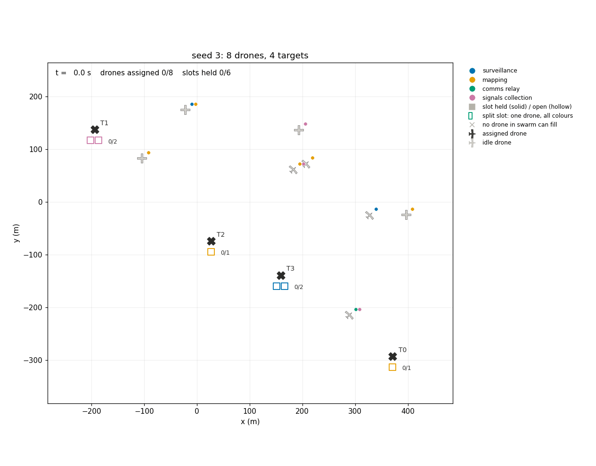
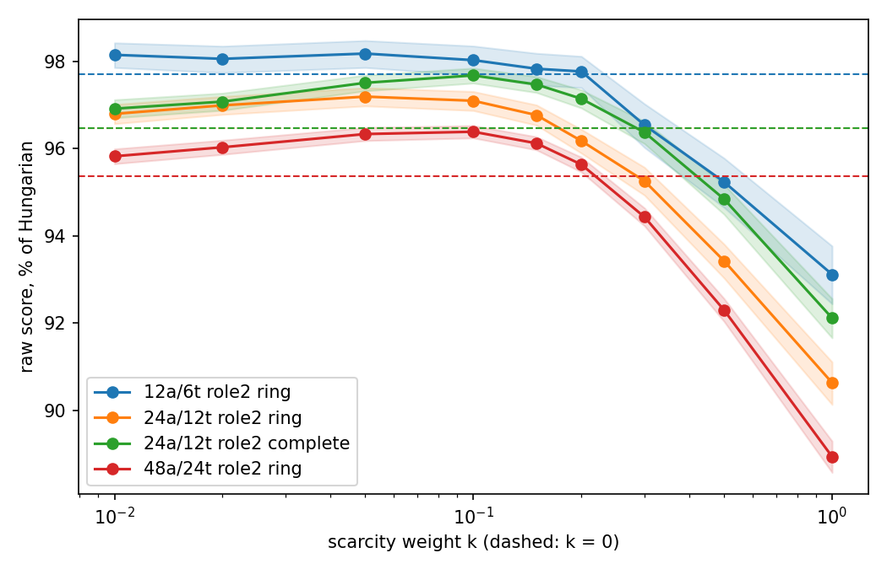

# Consensus-Based Decentralized Auctions for Heterogeneous Drone Swarms
[](https://github.com/stephen-barr/swarm/actions/workflows/tests.yml)

This is a from-scratch Python implementation of decentralized task allocation for a heterogeneous drone swarm. The fundamental problem it aims to solve is as follows:

***How can a decentralized swarm agree on coalition assignments when task demand, communication and the task set itself are all uncertain?***

Such a question is of broad interest to the field of autonomous systems. Consider the example below to illustrate its practicality:

*Medical triage via unmanned vehicles requires real-time coalition assignments with uncertain priority and capability requirements. Such systems are often needed in hostile environments where RF communication is jammed, leading to packet loss. How can a swarm accurately allocate capabilities to casualties?*

<p align="center"></p>

## Benchmark Results
800 random instances across four swarm sizes, each solved on complete, ring and line topologies and compared against the optimal (Hungarian) assignment.

| Drones | Targets | Infeasible | Mean % of optimal | 5th percentile | Worst | Exactly optimal | Coverage | Same as greedy |
|---|---|---|---|---|---|---|---|---|
| 6 | 3 | 6 | 99.3% | 98.7% | 69.5% | 94% | 99.1% | 98% |
| 12 | 6 | 0 | 97.9% | 90.4% | 83.6% | 55% | 96.7% | 92% |
| 24 | 12 | 0 | 96.7% | 92.1% | 89.2% | 10% | 95.7% | 72% |
| 48 | 24 | 0 | 95.4% | 91.5% | 85.8% | 0% | 95.7% | 43% |

- **Consistent assignment on every topology.** On all 1,600 instances, the line and ring assignments agreed with the complete topology (every agent can talk to every other agent), despite truly distributed communication. This holds for plain CBAA (k = 0); with scarcity weighting and a learned census, the outcome can depend on topology (see below).

- **Converges well inside of theoretical bounds.** Worst case instance only resulted in 67% of the theoretical maximum of rounds and improves with increased agents/targets.

- **Far above the worst-case guarantee.** The auction is theoretically guaranteed in the worst-case to reach half the optimum; the worst instance across all 800 runs reached 69.5%, and 95% of instances at every size reached at least 90%.

Full results, including convergence by network, and how to reproduce them: [experiments/docs/results.md](experiments/docs/results.md)

## Scarcity-Aware Bidding

In plain CBAA each drone bids its own value for a slot. A versatile drone therefore takes the slot it values most, even when it is one of the few drones able to fill some other slot, and that slot stays empty. Scarcity-aware bidding weights each bid by how hard its role is to staff.

No drone is given the roster. Each drone keeps a census of the drones it has heard of and their capabilities, merges its neighbours' censuses, and forwards its own only when it changes. From its census a drone counts, for each role it can fill, how many drones could fill that role. Its bid on a slot of role $r$ is its raw score multiplied by

$$w_r = \exp\left(-k \cdot \frac{n_r / d_r}{N / D}\right)$$

where $n_r$ is the number of drones in the census able to fill $r$, $d_r$ the number of slots requiring $r$, $N$ the census size and $D$ the total number of slots. The ratio compares the role's drones per slot to the swarm's average, so roles tighter than average are weighted up and looser ones down. Supply alone is not enough: a role few drones can fill is not a bottleneck if only one slot needs it. With $k = 0$ the auction is plain CBAA. Once censuses are complete, every drone bidding on a given slot applies the same weight to it, so the weight changes which slot a drone pursues, not who wins a contested slot.

First-round bids are made with a census containing only the bidder, when every role looks equally scarce. A drone therefore re-scores its held slot whenever its census grows and moves if another slot now scores higher. The census only grows and is bounded by the swarm size, so each drone's scores change finitely often, and after the last change the auction proceeds as standard CBAA.

Moving creates a second problem. A drone that moves withdraws its old bid, but a neighbour that has not yet seen the withdrawal can pass the old bid back, where it re-enters tables as if it were current; left alone this can livelock. Each bid therefore carries its author's version number, every drone tracks the latest version it has seen from each author, and older bids are discarded on arrival and pruned from the table.

### Results

Each regime below uses 500 random instances (24 drones and 12 targets unless stated, roles of up to 2 capabilities), run at every value of $k$ on identical drones and targets with the census learned during the auction. Scores are raw (unweighted) and given as a percentage of the Hungarian optimum.

| Regime | % of optimal, k = 0 | k = 0.1 | Gap to optimal closed | Slots filled | Rounds |
|---|---|---|---|---|---|
| 12 drones / 6 targets, ring | 97.7 | 98.0 | 14% | 8.59 → 8.70 | 14.0 → 16.3 |
| ring | 96.5 | 97.1 | 18% | 20.05 → 20.52 | 37.0 → 39.8 |
| complete | 96.5 | 97.7 | 34% | 20.05 → 20.58 | 5.7 → 6.4 |
| 48 drones / 24 targets, ring | 95.4 | 96.4 | 22% | 43.90 → 45.01 | 94.7 → 99.7 |

<p align="center">

</p>

The best $k$ lies between 0.05 and 0.1 in every regime, and in each it improves on $k = 0$ significantly (the paired bootstrap 95% interval of the difference excludes zero). The gain comes from coverage: across all 2,000 instances at $k = 0.1$, 42% fill at least one more slot, 3% fill one fewer, and the rest fill the same number with essentially unchanged score. Re-scoring as the census arrives costs 5–16% more rounds. Beyond $k \approx 0.15$ the number of slots filled keeps rising but score falls, and at $k = 1$ it is 5–7.5 points below the best.

These results have limits. $k$ was chosen on the same instances reported here; paired comparison keeps the selection bias small, but a run on fresh instances is still to do. With a learned census, bids made before the census is complete depend on how fast it spreads, so the outcome depends on topology, whereas with the roster known in advance it does not. The weight is also soft: a role that only one drone can fill is a hard bottleneck, yet at small $k$ that drone still takes another slot it values much more (`experiments/basic_example.py` needs $k = 2$ to show the switch). Such bottlenecks can be found exactly and locally, since the census and slot list define a bipartite graph whose maximum matching identifies slots that cannot be filled without a particular drone.

Finally, in the current static setting a drone holding the full census and every position could compute the optimal assignment itself, so a share-then-solve baseline (diameter rounds, 100% of optimal) belongs in the benchmark. The auction earns its place under the partial, lossy and changing information of the later stages below, and in the coalition and bundle problems where exact solving is NP-hard.

## Status and Direction

Currently this project implements decentralized single-assignment auctions (CBAA) with multi-capability roles, checked against the optimal assignment found through a Hungarian algorithm.

I aim to incrementally add uncertainty to a working implementation of the standard consensus auction algorithm.

1. **Single assignment (CBAA): done.** Everything is known and fixed: tasks, demand, and a reliable, synchronous network.
   - **Scarcity-aware bidding: done.** Distributed census, demand-aware weighting, re-scoring, and versioned bids (above). Next: share-then-solve baseline, hard-bottleneck detection, confirmation on fresh instances.
2. **Bundles (CBBA): next.** Not yet introducing uncertainty. Agents are assigned ordered lists of targets instead of a single assignment. Coalitions in the CBBA line are built on bundles, so this comes first.
3. **Coalitions under uncertain demand: partial.** First uncertainty: how many drones a target actually needs. Multi-capability roles and multi-drone targets are implemented already, but slots are auctioned independently (no coupled constraints) and demand is fixed at its most likely value before bidding starts.
4. **Degraded communication: planned.** Second uncertainty: message loss between agents. Implemented to measure the robustness of the algorithm to disruptions. The channel supports a fixed delay, currently.
5. **Tasks arriving mid-mission: planned.** Third uncertainty: which tasks exist. Solves real-time target identification from perception, with the cost of changing a drone's current assignment.

## Assumptions (current)
 
- Synchronous rounds over a static, connected, symmetric communication graph.
- Drones learn which other drones exist only through the census; target positions and requirements are known to all.
- One slot per drone.
- Drones and targets are stationary; positions are in the global frame.
- Demand is fixed at its most likely count before bidding.


## Scoring: time-discounted value

Each drone scores a slot by the target's value, discounted by how long the drone would take to get there:

$$\text{score} = V \cdot e^{-t/\tau}$$

- **V** is the target's value to the mission (currently `threat_level`).
- **t** is the drone's own time to arrival (distance ÷ cruise speed), so scores are local to each drone.
- **τ** (tau) is a characteristic time: value halves every 0.69 τ seconds, so τ = 30 s means value halves roughly every 21 s.

**Why this form**


- **Scores are never negative**, so any assignment the auction makes is worth something.

- **It supports bundles.** Adding tasks to a drone's path can only delay the others, so marginal gains only decrease, the condition CBBA's convergence and optimality guarantees require.

**Behaviour**

- V sets how high a target's curve starts; τ sets how quickly it falls.
- Curves can cross: an urgent, valuable target (V = 0.8, τ = 30 s) becomes worth less than a patient, modest one (V = 0.3, τ = 90 s) after about 44 s of travel. Nearby drones prefer the first; distant ones, the second.

<p align="center">

</p>

## Tests
 
```bash
pip install -e .
pytest
```
 
- `tests/test_comm.py`: channel delivery, copying, ordering, delay.
- `tests/test_auction.py`: hand-built cases, plus properties over random instances on complete, ring and line graphs (conflict-free, capabilities respected, terminates, tables agree, deterministic, within ½·OPT ≤ auction ≤ OPT).
- `tests/test_baseline.py`: Hungarian baseline against brute force.
- `tests/test_latest.py`: version tracking; stale and echoed bids are rejected and pruned.
- `tests/test_scarcity.py`: weight values, demand changing the weight, and re-scoring moving a versatile drone to a scarce slot.

## Layout
 
```
swarm/
  models.py      shared types
  agent.py       scoring, bidding, merging
  comms.py       simulated network
  auction.py     rounds and stopping rule
  baselines.py   Hungarian baseline
  scenarios.py   graph builders, fixtures, random instances
experiments/
  basic_example.py   scarcity weighting on one four-drone instance
  benchmark.py       auction vs Hungarian and greedy over random instances
  summary.py         tables from the benchmark
  k_sweep.py         scarcity weight k vs score, fill and rounds
  docs/              full benchmark results, figures
tests/
```
 
## References
 
- Choi, H.-L., Brunet, L., How, J. P. Consensus-Based Decentralized Auctions for Robust Task Allocation. *IEEE Transactions on Robotics* 25(4), 2009.
- Hunt, S., Meng, Q., Hinde, C., Huang, T. A Consensus-Based Grouping Algorithm for Multi-agent Cooperative Task Allocation with Complex Requirements. *Cognitive Computation* 6, 2014.
- Kuhn, H. W. The Hungarian Method for the Assignment Problem. *Naval Research Logistics Quarterly* 2, 1955.


All rights are reserved.
